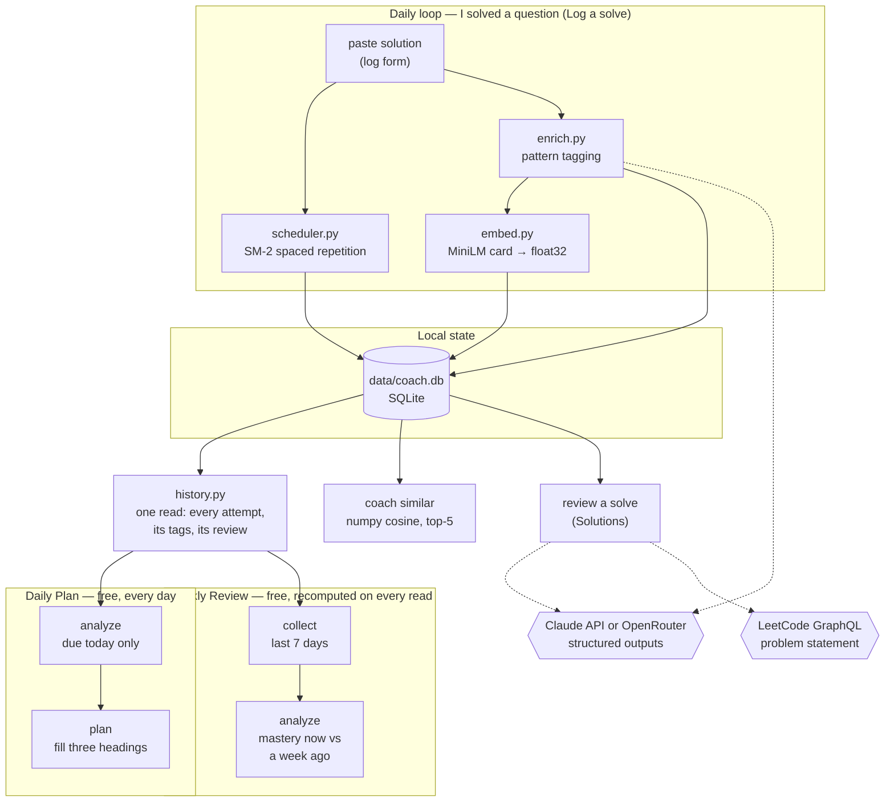

# Design overview

How the parts fit together. Each part has its own page in this directory, linked below;
this one keeps the picture and the rules that cross every part.
For installing and running it, see the [README](../README.md).

---

## Architecture



Solid arrows stay on the machine; dotted arrows leave it — the model's API (Anthropic's,
or OpenRouter's) for enrichment and reviews, LeetCode for a problem's statement. Every one
of them degrades to a working local path when the network or the key is unavailable.

How a request reaches the logic, and how one solve travels to every page: [web.md](web.md).

---

## Design decisions

How the language model tags and reviews solves, and what happens when it cannot answer:
[llm.md](llm.md).

How an attempt is graded, the review schedule, mastery per pattern, approach practice, the
Daily Plan and the Weekly Review: [logic.md](logic.md).

How similar past solves are found, and why each solve has its own vector:
[search.md](search.md).

How the practice history is read, once per request: [history.md](history.md).

**One copy of everything.**
`coach.db` is the only place a solve lives. Two mirrors have been removed for the same
reason: a per-problem `solutions/NNNN-slug.py` file, and a frozen weekly report. Both were
written on every update and read by nothing inside the application, and a second copy that
nobody reads is a second copy that can be wrong. The same rule retired the daily CLI
commands: every daily feature existed as a service function, a CLI printer and a web page,
and once the page could do everything the printer did, nobody read the printer.

How a solve is stored, and what deleting one removes: [database.md](database.md).

---

## Does it actually work?

How the language model is measured instead of trusted - the bank, the execution oracle,
the held-out split and what the runs showed: [evals.md](evals.md). Every run's numbers:
[evals/RESULTS.md](../evals/RESULTS.md).

---

## Layout

```
coach/          CLI, service layer, SQLite schema, scheduler, LLM wrapper, enrichment, embeddings
coach/history.py  the one read of practice history; mastery, corrections, assessment are pure over it
coach/weekly/   collect → analyze (plan.py builds the daily list)
coach/web/      FastAPI app + the static Home, Log a solve, Solutions, Daily Plan and Weekly Review pages
evals/          execution oracle, fixture bank, corpus, scorers, RESULTS.md
tests/          the whole suite, no network
docs/           this overview, and one page per part (database, history, logic, llm,
                search, web, testing, evals)
```
