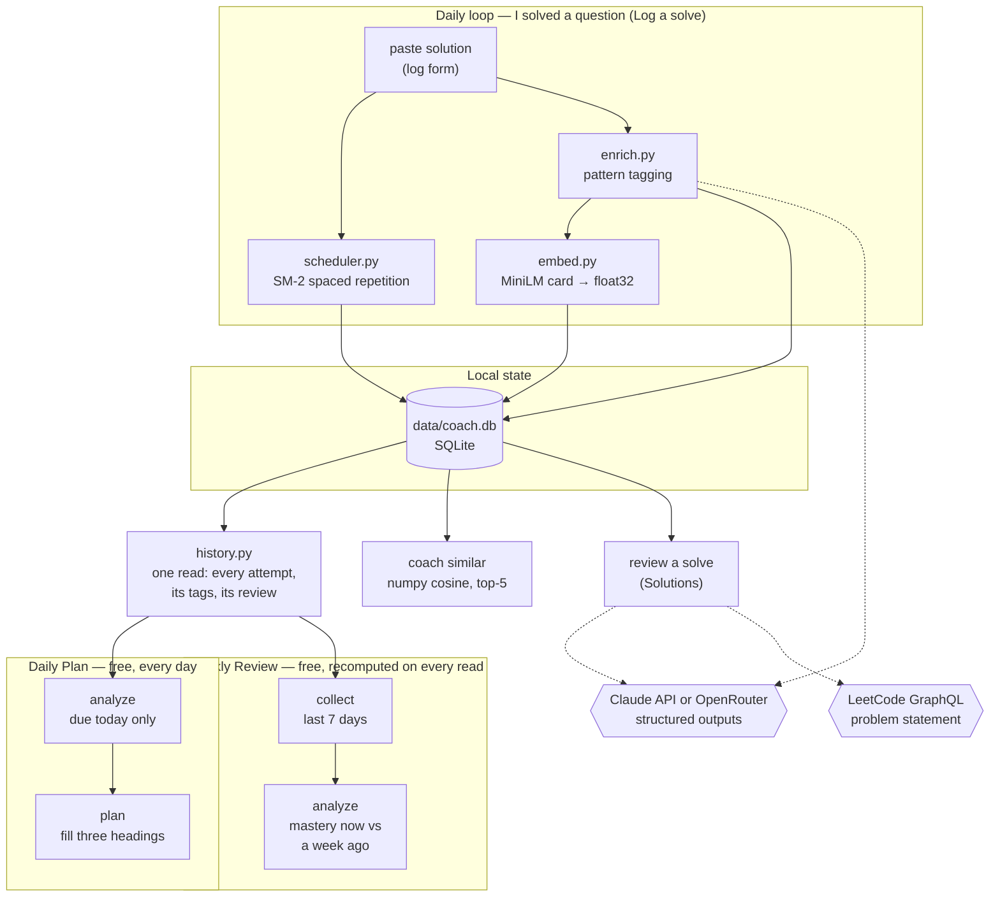

# Design record

Why this tool is built the way it is, and what was measured rather than assumed.
For installing and running it, see the [README](../README.md).

---

## Architecture



Solid arrows stay on the machine; dotted arrows leave it — the model's API (Anthropic's,
or OpenRouter's) for enrichment and reviews, LeetCode for a problem's statement. Every one
of them degrades to a working local path when the network or the key is unavailable.

The web UI is the daily interface; the CLI keeps only the jobs with no page (`init`,
`enrich`, `similar`). Both are thin layers over one implementation
([`coach/service.py`](../coach/service.py)), so they cannot drift into disagreeing.
Enrichment is the sharpest case: logging a solve and the `coach enrich` backfill both run
`service.tag_solution_now()`, and differ only in how they embed — one card per solve, or
one batch at the end.

---

## Design decisions

How the language model tags and reviews solves, and what happens when it cannot answer:
[llm.md](llm.md).

How an attempt is graded, the review schedule, mastery per pattern, approach practice, the
Daily Plan and the Weekly Review: [logic.md](logic.md).

How similar past solves are found, and why each solve has its own vector:
[search.md](search.md).

How the practice history is read, once per request: [history.md](history.md).

**One copy of everything.**
`coach.db` is the only place a solve lives. Two mirrors have been removed for the same
reason: a per-problem `solutions/NNNN-slug.py` file, and a frozen weekly report. Both were
written on every update and read by nothing inside the application, and a second copy that
nobody reads is a second copy that can be wrong. The same rule retired the daily CLI
commands: every daily feature existed as a service function, a CLI printer and a web page,
and once the page could do everything the printer did, nobody read the printer.

How a solve is stored, and what deleting one removes: [database.md](database.md).

---

## No automation, by design

Nothing here runs unattended. There is no cron job, no systemd timer, and no scheduled
writer, because there is nothing left to schedule: the weekly review is computed the
moment you ask for it, from the database, in a few milliseconds.

That is the second time this project has arrived at *pull, don't push*. A GitHub Actions
cron wrote the report first, and was dropped because it meant leaving a live API key and
an automated writer on a repo run by hand. The systemd timer that replaced it then proved
the point on its own: it fired on a Sunday with no network, wrote a report missing the
one part that needed the network, and overwrote that week's good one. Removing the stored
report removed the last thing a scheduler was for.

---

## Does it actually work?

The point of the eval harness is that "the feedback looked good" is not a claim you can
defend or iterate against. Full numbers and methodology:
**[evals/RESULTS.md](../evals/RESULTS.md)**.

### Review feedback — 32 problems it was never tuned on

| Metric | Result |
|---|---|
| Recall on planted flaws | **88%** (74/84; 95% CI 79–93%) |
| False-positive rate: proven-correct code called wrong | **3%** (2/59; 95% CI 1–12%) |
| By category | bug 84% · complexity 100% · edge-case 71% (of 7) |
| Complexity remarks on correct code, scored neither way | 17% (10/59) |

Measured on `review-v6`, the prompt the coach ships, with `claude-sonnet-5`, on `bank-v5`'s
held-out `test` split: 4 Easy, 18 Medium and 10 Hard problems drawn by a fixed seed after
the selection rules were fixed, every correct solution written outside this repo, and
the bank committed before any review call on it. Two of 145 calls ran out of tokens and
are left out: reviews think, thinking counts toward the limit, and on terse code whose
correctness rests on an unexplained trick one review used 29,387 tokens before it could
answer. Reviews therefore stream with room for 32,000. Sonnet 5 is the coach's default
model; no free model has been scored.

A false positive counts only a claim that correct code is wrong, which is exactly what
caps a grade in the coach. It used to count any issue, and on `review-v4`'s split that
read 20%; 8 of those 10 were remarks that code could use less space, which the oracle
cannot call false, since it proves a control correct and no slower than the canonical,
not optimal. By either definition the two prompts are level (4% and 20% for v4, 3% and
19% for v6): the headline moved because the question did, not the prompt.

The false-positive rate matters as much as recall: a reviewer that reports five issues
on every solution scores perfect recall and is useless, because it would send you
re-solving problems you already got right.

**Ground truth comes from executing the code, never from an opinion.** Canonical
solutions are mutated using a taxonomy of common mistakes fixed in advance, then run
against a test harness. A mutant that fails a representative input is a `bug`; one that
fails only at a boundary is an `edge-case`; one that is correct but ≥5× slower at scale
is a `complexity` flaw; and one the tests cannot distinguish from the original is
**discarded**. That discard rule means weak tests cost fixtures rather than producing
mislabelled ones — the safe direction to fail. It also means the author of a planted
flaw is not the authority on whether it is real.

**Labels are proven, not just tested.** A handful of hand-written tests can let a broken
mutant through, so every problem also carries a brute force written to be obviously right
and a generator of the random inputs its constraints allow. Code that passes the tests but
disagrees with the brute force on any of up to a thousand generated inputs stops the bank
with `TestsTooWeak` until a test covers that input.

**Clean controls are held to the same standard, and the test split's were written
elsewhere.** A control must pass every test, agree with the brute force, time within 5× of
the canonical, and not need megabytes where the canonical needs almost none. The test
split's come from NeetCode's and walkccc's published solutions, copied unmodified at pinned
commits - one that breaks a rule is rejected with its reason, never fixed (67 accepted, 50
rejected) - and from the author's own clean solves, kept out of git. A false-positive line
in the report quotes the model's claim, because on code proven correct the claim is the part
worth arguing with - but on the author's own solves that claim can quote the solution, so
those lines keep only their categories and the words stay in the gitignored cache. Controls
written in this repo count only on `dev`, where six that probe false positives an earlier
run showed are scored apart so they cannot flatter the rate.

**The test split is held out by construction.** The 47 problems added for it were divided
mechanically - within each difficulty, sorted by number, alternating - and the whole bank,
tests and mutants included, was committed before any review call on it. Its misses and
false positives stay out of the report until `--reveal-test`, because reading them is how a
prompt gets tuned to them.

### The result worth reading

**Two prompt iterations produced no measurable improvement.** `review-v1` and
`review-v2` tie at 29/30; they differ only in *which* fixture they miss, and both misses
are the same defensible dispute about where "bug" ends and "edge-case" begins.

What actually moved the number from 93% to 97% was **fixing the eval** — three
independent defects in the ground truth, every one found because the model disagreed
with a label and the disagreement turned out to be its point:

1. Inputs marked as boundary cases that were nothing of the kind (different-length
   strings are an ordinary input to an anagram check).
2. Tests that violated the problem's own constraints — empty arrays fed to problems
   whose constraints state `1 <= length`. A defect on an input the problem excludes is
   not a defect. Removing those tests made three mutants indistinguishable from the
   original, and the oracle discarded them on its own.
3. A "clean" control that was not clean: it iterated `prices[1:]`, allocating an O(n)
   copy, and the model was scored as a false positive *for being right about it*.

Because that is where the value turned out to be, a miss in the report now carries the
execution evidence behind its label, so the next disagreement can be adjudicated rather
than merely counted.

**Then a model switch broke the false-positive rate, and the eval caught it.** Moving to
`claude-sonnet-5` with `review-v3` kept recall at 29/30 but took false positives from 0/13
to 3/13: "an empty list raises IndexError" on problems whose constraints rule an empty
input out, and "O(n) is not optimal" for Climbing Stairs at `n <= 45`. That is not
cosmetic - a reported edge case caps an attempt's grade below SM-2's passing line, so a
correct solve would lapse. Thirteen controls could not have measured a fix (0/13 still
allows a true rate near 23%), so the bank grew to 35 clean controls first. The unchanged
prompt scored 4/35 there; `review-v4` added one rule - judge against the problem's stated
constraints and guarantees, and ignore faster algorithms that make no difference at the
allowed sizes - and scored 0/35 with recall unchanged. Every false positive went and none
appeared, but four fixtures in one run is suggestive rather than conclusive; RESULTS.md
has the caveats.

**Then a held-out split showed the tuned numbers do not transfer.** On 25 problems no
prompt had been written against, the same prompt caught 82% of planted flaws and flagged
20% of correct solutions - against 0/35 on the tuned problems, Fisher exact p = 0.004.
Reading the revealed lines splits that 20% in two. Eight of the ten claims are
defensible: extra space that the canonical solution uses too, which the oracle measures
only relatively, and recursion deeper than CPython's default limit, which the oracle
raises. So "clean" has to mean optimal before that rate is the reviewer's alone. The
misses are the reviewer's: eight bugs that fail one of LeetCode's own examples, each a
small edit to a famous published solution, drew no comment at all.

**Then the rate was narrowed to what the oracle can prove.** Making "clean" mean optimal
would have meant rejecting most published canonicals, which are never edited. Instead a
false positive became a claim that correct code is wrong, decided and committed before
the next split was scored, with complexity remarks reported beside it and scored neither
way. That split - 32 problems drawn by a fixed seed, every input checked against the
problem's own constraints - gave `review-v6` 88% recall and 3% false positives, and by
the new definition v4's 20% had been 4%.

### Pattern tagging and retrieval

| Eval | Result |
|---|---|
| `intended_pattern` vs NeetCode's published Blind 75 sections (`enrich-v5`) | **97%** (29 problems) |
| Retrieval recall@5 — enriched cards | **79%** |
| Retrieval recall@5 — raw code | 62% |

Enriched cards beat raw code by 17 points on `enrich-v5`, up from 5 on `enrich-v2`: one
run on 42 pair directions, so read it as a clear direction more than a precise size. The
misses that remain cluster where this small corpus is dense - 1-D DP problems, and a
graph/tree trio - with several labelled pairs competing for five result slots.

Known limitations — "clean" measured against the canonical rather than the optimum, small
`edge-case` samples, a bank of plain-value problems, controls that cluster on a few
problems, and the fact that mutation *choice* remains authored even though every label is
executed — are listed in [evals/RESULTS.md](../evals/RESULTS.md#known-limitations).

### Running the evals

```bash
uv run python -m evals.validate_bank                        # prove every label and control, no API calls
uv run python -m evals.run_evals --all --dry-run            # count the calls and the cost first
uv run python -m evals.run_evals --feedback --split test    # the held-out split: 121 calls, about $3
uv run python -m evals.run_evals --feedback --split test --reveal-test   # free from the cache; spends the split
```

`--dry-run` counts the calls a real run would make with the same code that buys them, so
the two cannot disagree. Responses cache by prompt version, model, and a digest of the
code they scored, so a repeat run costs nothing, correcting a *label* re-scores for free,
and editing a *fixture* re-buys just that fixture.

Published solutions enter through `python -m evals.bank.import_external fetch <n>` and
`judge`, which record every rejection with its reason; your own clean solves through
`python -m evals.bank.import_private --db <copy of coach.db>`, into a gitignored store.

---

## Layout

```
coach/          CLI, service layer, SQLite schema, scheduler, LLM wrapper, enrichment, embeddings
coach/history.py  the one read of practice history; mastery, corrections, assessment are pure over it
coach/weekly/   collect → analyze (plan.py builds the daily list)
coach/web/      FastAPI app + the static Home, Log a solve, Solutions, Daily Plan and Weekly Review pages
evals/          execution oracle, fixture bank, corpus, scorers, RESULTS.md
tests/          the whole suite, no network
docs/DESIGN.md  this file
```
