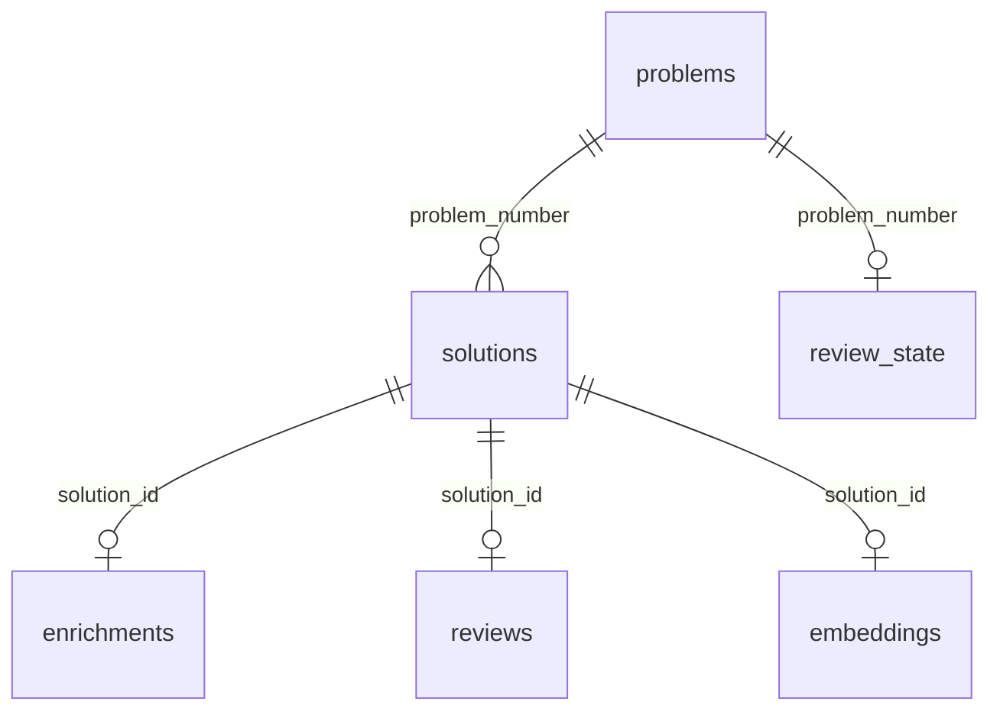

# Database

SQLite, written in raw SQL with no ORM. The schema is in [coach/db.py](../coach/db.py), and
only `coach init` creates or changes it.

## Why SQLite

The coach has one user, on one machine: the web server binds to localhost and has no
authentication. That is the case SQLite is built for.

- **No server.** SQLite is a library inside the Python process (`sqlite3`, in the standard
  library), and the whole database is one file, `data/coach.db`. There is nothing to install,
  start or connect to over the network.
- **A database per test.** Each test points `config.DB_PATH` at a fresh file in its own
  temporary directory (`seed_db` in [tests/conftest.py](../tests/conftest.py)), so tests never
  share state and never touch the real file. `COACH_DB=/path/scratch.db` does the same for any
  command, `coach-web` included.
- **A backup is a copy.** Before a migration, `data/coach.db` is copied to `data/backups/`.
  Both are gitignored: the file holds a practice history, not the tool, so nothing in git backs
  it up.
- **Vectors fit in it too.** Each solve's embedding is a `float32` array stored as a `BLOB`, and
  search is a brute-force cosine over all of them in numpy. At a few hundred solves that takes
  milliseconds, so there is no vector database.

What it costs:

- **One writer at a time.** A write locks the whole database. With one user that never matters.
- **Loose types.** SQLite stores whatever it is given, whatever the column's declared type, so
  the schema leans on `NOT NULL` and `CHECK` constraints. Lists (patterns, issues, tags) are JSON
  text, such as `'[]'`.
- **No shared deployment.** Several users or devices would need a database server such as
  Postgres. The SQL is written by hand, so moving would mean translating it, not replacing an
  ORM's model layer.

## The tables

- **`problems`**: the LeetCode catalog, every problem whether solved or not (about 4,000),
  loaded by `coach init`. `upsert_problems` inserts with `ON CONFLICT(number) DO UPDATE`, so
  rerunning it refreshes titles and tags without touching the three columns the coach adds:
  `intended_pattern` and `intended_secondary_patterns` (the problem's accepted approaches,
  merged from the model's answers by `enrich.save_intended`), and `content` (the statement,
  fetched on a problem's first review and kept).
- **`solutions`**: one row per solve: the day, how it went (`outcome`, limited by a `CHECK` to
  `clean`, `struggled`, `hints` or `failed`), minutes, a note, the code, and whether the problem
  was due that day. `service.log_solve` is the only writer and `service.delete_solve` the only
  deleter.
- **`enrichments`, `reviews`, `embeddings`**: at most one row per solve each, with
  `solution_id` as the primary key. They are tables of their own rather than columns on
  `solutions` because each is filled later and on its own: tags need the model, a review runs
  only when asked for, and a vector needs the optional `embed` extra. A missing row means "not
  yet". Each enrichment and review records the `model` and `prompt_version` that produced it.
- **`review_state`**: a problem's spaced-repetition schedule, one row per attempted problem.
  It is the only table computed from the others: `service.update_review_state` replays every
  attempt of the problem and overwrites the row, in the same transaction as the change that
  caused it. It is stored because "what is due today" is a query over `next_due`.

Lists (patterns, data structures, strengths, issues, official tags) are stored as JSON text
rather than in tables of their own. Every list is read whole and filtered in Python; no SQL
looks inside one.

There are no indexes beyond the primary keys and `problems.slug`'s `UNIQUE`. SQLite does not
index a foreign key column on its own, so `WHERE problem_number = ?` scans `solutions`, which
at a few hundred rows takes microseconds.

## Changing the schema

`db.connect()` never creates or changes the schema; only `coach init` does, through
`init_schema`. Everything in it can run again on a database that already has it:

- **A new table** is just added to the schema: every table is `CREATE TABLE IF NOT EXISTS`.
- **A new column** needs an `ALTER TABLE ... ADD COLUMN`, because `IF NOT EXISTS` skips a table
  that already exists whatever its columns. Each one is guarded by a look at
  `PRAGMA table_info`, so it runs only on a database that lacks the column.
- **Removing or reshaping a column** needs the table rebuilt: create it in the new shape, copy
  the rows over, and drop the old one, inside one transaction. Never rename a table that others
  reference to move it aside: SQLite rewrites the incoming `REFERENCES` to follow the rename,
  so the children end up pointing at the copy about to be dropped. Foreign keys are turned off
  for the rebuild, since SQLite refuses to drop a table that other rows still point into.
  Worked examples are in git: `b2bbe74` (`enrichments.pattern` became `main_patterns`) and
  `fd25ed7` (`attempts` merged into `solutions`).

## Connections and transactions

`db.connect()` opens the file, returns rows readable by column name (`sqlite3.Row`), and turns
on foreign keys. SQLite leaves them off by default, and the setting lasts only for that
connection, so every connection sets it.

Python's `sqlite3` opens a transaction on the first write and saves nothing until `commit()`.
A change that spans several statements runs inside `with conn:`, which commits if the block
finishes and rolls back if it raises. `service.delete_solve` is the clearest case: the solve's
enrichment, review and embedding, the solve itself, and its problem's replayed review schedule
are deleted or rewritten together or not at all. The foreign keys have no `ON DELETE CASCADE`,
so the children are deleted first, by name.

The journal mode is SQLite's default rollback journal: during a write, the pages it is about to
change are copied to `coach.db-journal`, so a crash mid-write is undone the next time the file
is opened. A write locks the whole file, and another connection that wants to write waits up to
five seconds (Python's default) before failing with `database is locked`. Write-ahead logging
(`WAL`), which lets readers carry on during a write, is not turned on: one user never needs it.

A connection may only be used on the thread that opened it, so the web API opens one inside
each endpoint rather than sharing one through FastAPI's dependency injection, which runs on a
different thread from the endpoint.

## Who writes what

Each table has one writer, so a rule about what a row holds lives in one function. Every write
that spans more than one statement runs inside `with conn:`, so it is saved whole or not at all,
whoever called it:

- **A solve** is written only by `service.log_solve`, which inserts it and replays its
  problem's schedule, and deleted only by `service.delete_solve`.
- **Tags** are written by `service.tag_solution_now`, which also discards the solve's vector
  (it described the old tags) and merges the problem's accepted approaches.
- **A review** is written by `service.review_solution_now`, together with the replayed schedule.
- **A vector** is written by `embed.store`, during logging or `coach enrich`.

Deleting a solve deletes its rows and nothing else: its tags, review and vector, then the solve.
Mastery, the plan, approach practice and the week are computed on every read, so they drop it on
their own. The schedule is the one thing stored from the solves, and since it is a replay rather
than a running total there is nothing to subtract: it is replayed from what is left, or removed
with the problem's last solve, since a problem never attempted is never due. The problem's
accepted approaches stay, because they describe the problem, not the solve. There is no undo:
`data/coach.db` is the only copy, so the page asks first.

The model is called before any of these opens a transaction. Logging commits the solve first and
tags it after, in a transaction of its own, so a slow or failed model call never holds the write
lock and never loses a solve.

Every value reaches SQL through a `?` placeholder, never pasted into the query text. The one
query built with an f-string, in `delete_solve`, takes its table name from a fixed tuple in the
code.
